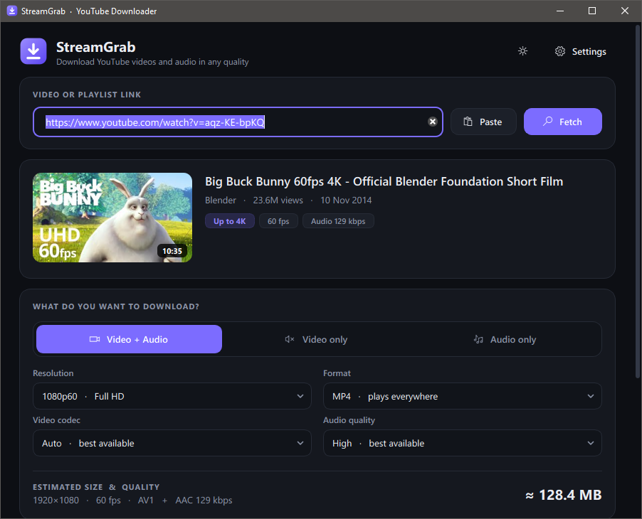

# StreamGrab

A clean, modern Windows app for downloading YouTube videos, playlists and audio in the quality you choose. Powered by **yt-dlp** and **FFmpeg**. Free, no ads, no account.



## Download

**[⬇ Download the latest version (StreamGrab_Setup_1.0.1.exe)](https://github.com/Wafic2004/StreamGrab/releases/latest)**

1. Download `StreamGrab_Setup_1.0.1.exe` from the **Releases** page.
2. Run it. If Windows shows *"Windows protected your PC"*, click **More info → Run anyway** (the installer isn't code-signed).
3. Click **Next → Next → Install**. No administrator password is needed.

Everything StreamGrab needs is inside the setup file (FFmpeg, Deno and the Python/Qt runtime), so nothing else has to be installed.
Requires 64-bit Windows 10 or 11 and about 670 MB of disk space.

## Features

| Mode | What you get | Formats | Quality choices |
|---|---|---|---|
| **Video + Audio** | Normal video with sound | MP4, MKV, WebM, MOV, AVI | Every resolution the video offers (144p to 4K/8K, 60 fps), codec (H.264 / VP9 / AV1), audio quality |
| **Video only** | Picture only, no sound track | MP4, MKV, WebM, MOV, AVI | Resolution, fps, codec |
| **Audio only** | Music / podcast file | MP3, M4A, AAC, Opus, OGG, FLAC, WAV, Original | 320 to 64 kbps, lossless, or untouched original |

Also:
- **Live size estimate** with the exact streams before you download, plus warnings (e.g. "H.264 isn't offered at 4K").
- **Save-to folder** (remembered) with Open folder, Show in folder and Play buttons. Asks before replacing an existing file.
- **Progress** with speed and time left; **Cancel** removes partial files.
- **Playlists**: paste a playlist link, or tick "Download the entire playlist" on a video inside one. Unavailable items are skipped and reported.
- **Cover art and tags** embedded into audio files.
- **Dark / light / match-Windows theme**, drag-and-drop links, clipboard detection, full keyboard support.
- **Settings**: file-name pattern, playlist subfolders, browser cookies (for age-restricted videos), one-click **engine update**.
- **Fast**: links load in about 2 s and downloads start in about 1–2 s.

**If downloads start failing** (YouTube changes often): Settings → **Check for updates**, then restart the app.

Please only download videos you have the right to save (your own uploads, Creative Commons, etc.) and respect YouTube's Terms of Service.

## Test documentation

StreamGrab 1.0.1 went through two full test cycles. See [docs/TEST_SUMMARY.md](docs/TEST_SUMMARY.md).

| Document | Contents |
|---|---|
| [StreamGrab Test Plan.pdf](docs/StreamGrab%20Test%20Plan.pdf) | Scope, approach, environments, entry/exit criteria |
| [StreamGrab_Test_Cases.xlsx](docs/StreamGrab_Test_Cases.xlsx) | 101 test cases with results, defect log (16 defects, all closed), test data and cycle summary |
| [TEST_SUMMARY.md](docs/TEST_SUMMARY.md) | Results at a glance |

## Building from source

Requirements: Windows 10/11 x64, Python 3.13, and the three helper programs in `bin\` (see [bin/README.md](bin/README.md)).

```bat
python -m venv .venv
.venv\Scripts\pip install -r requirements.txt
"Run StreamGrab (dev).bat"          &REM run from source
build.bat                           &REM build dist\StreamGrab\StreamGrab.exe (portable folder)
installer\build_installer.bat       &REM build installer\Output\StreamGrab_Setup_<version>.exe
```

The installer needs Inno Setup 6 (`winget install JRSoftware.InnoSetup`). `installer\build_installer.bat /full`
rebuilds the app first. The version number comes from `streamgrab\__init__.py`.

### Tests

```bat
.venv\Scripts\python tests\test_fixes.py                       &REM fast unit checks, no network
.venv\Scripts\python tests\run_cases.py OUT VA-01,AO-01,VO-01  &REM real downloads checked with ffprobe
.venv\Scripts\python tests\run_extra.py OUT CN-02,SV-09,ER-02  &REM cancel, existing file, network drop...
```

`tests\netsim.py` is a tiny local proxy used to simulate the network dropping mid-download.

## Project layout

```
streamgrab\
  main.py              app start-up (fonts, icon, taskbar id)
  window.py            main window UI
  settings_dialog.py   settings window
  engine.py            runs yt-dlp in-process (fast client + fallback), progress, cancel, cleanup, updater
  formats.py           turns yt-dlp's format list into friendly options + size estimates
  theme.py             dark / light stylesheet
  icons.py             app logo + Windows Fluent glyph icons
  utils.py             link checks, formatting, file helpers
installer\             Inno Setup script, wizard images, build script
tests\                 unit checks, download test runners, network simulator
docs\                  test plan, test cases workbook, test summary
bin\                   ffmpeg.exe, ffprobe.exe, deno.exe (not in Git, see bin\README.md)
```

## How it's fast

yt-dlp is loaded once and kept warm inside the app. Fetches use YouTube's lightweight "visionos" client, which
needs no JavaScript challenge, and fall back to yt-dlp's full client set if that fails. Downloads reuse the fetched
info instead of asking YouTube again, and refresh the links automatically if they've expired. `deno.exe` is the
JavaScript runtime yt-dlp needs for the fallback path.

## License

StreamGrab is released under the [MIT License](LICENSE). Bundled third-party programs (FFmpeg, Deno, yt-dlp, Qt,
Python) keep their own licenses; see [THIRD_PARTY_NOTICES.md](THIRD_PARTY_NOTICES.md).

Changes to this repository are made only by the maintainer. Bug reports and suggestions are welcome as
[issues](https://github.com/Wafic2004/StreamGrab/issues).
